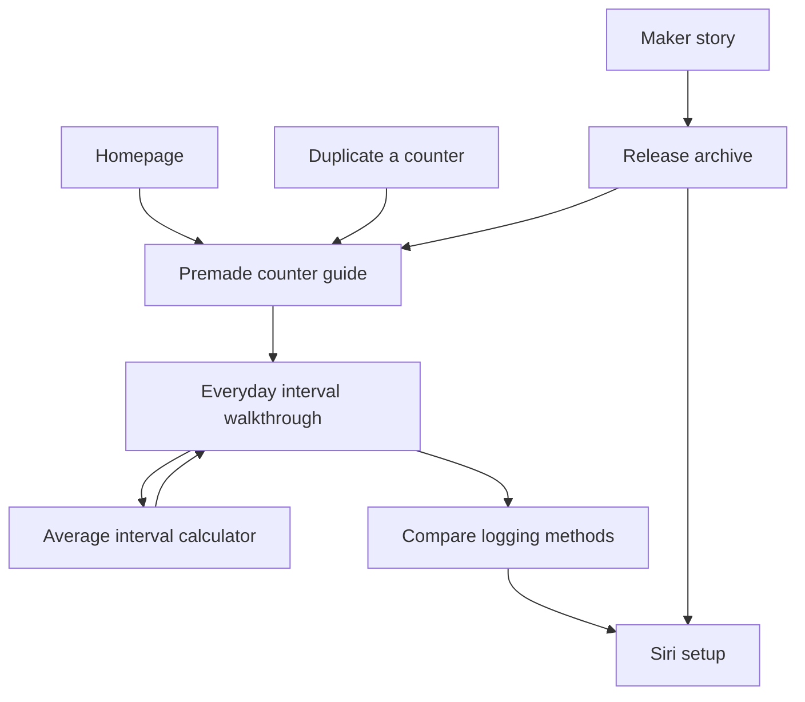

# TimeSince content inventory and publication plan

22 November 2026 · English website and iPhone app

## Existing pages

The site has **37 reader-facing pages**. I checked the live URLs from the sitemap and the feature registry. The sitemap lists 26 pages. All 11 feature detail pages also resolve, including the Siri page. The old `/blog` paths redirect to Guides. Counts below exclude redirects, feeds, metadata and the App Store referral endpoint. [Live sitemap](https://www.timesinceapp.com/sitemap.xml) · [Feature directory](https://www.timesinceapp.com/features)

| Section | Existing URLs | Editorial decision |
| --- | --- | --- |
| Home and hubs · 5 | `/`, `/features`, `/guides`, `/scenarios`, `/tools` | Feature the new Explore guide on the homepage and Guides index. Keep the other hubs for their current reader tasks. |
| Guides · 7, under `/guides/` | `tracking-irregular-chores`, `log-a-habit-without-opening-the-app`, `what-timesince-pro-adds`, `quitting-with-a-counter-that-climbs`, `where-your-data-lives`, `habit-tracking-with-adhd`, `why-streaks-backfire` | Refresh the chores walkthrough and the three-method logging comparison. Link the Pro, quitting and privacy explainers where their detail helps. Retain the ADHD and streak guides for their distinct audiences. |
| Features · 11, under `/features/` | `counter-customization`, `rhythm-analytics`, `hidden-counters`, `custom-logging`, `timeline`, `home-screen-widget`, `siri-shortcuts`, `nfc-tags`, `quitting-mode`, `reminders`, `icloud-backup` | Expand Siri into the setup reference. Use customization for the link into Explore, rhythm and Timeline for reading intervals, and iCloud for the dated-backups release. Retain the remaining feature pages as references. |
| Scenarios · 6, under `/scenarios/` | `too-many-near-identical-counters`, `set-it-up-now-start-it-later`, `one-widget-not-eight`, `the-wrong-counter-on-my-lock-screen`, `arguing-about-whose-turn-it-was`, `i-want-a-streak-counter` | Link duplication to Explore for readers who need their *first* counter. Keep reminder starts, widget configuration, shared-household expectations and streak questions on their existing pages. |
| Calculators · 3, under `/tools/` | `days-since`, `days-between`, `average-interval` | Keep the arithmetic on these pages. Link the average-interval result to the worked everyday example for readers who want to keep logging. |
| Release, maker and support · 3 | `/whats-new`, `/about`, `/faq` | Refresh the archive. Use About for the maker’s reasons and FAQ for short answers with links to setup. |
| Legal · 2 | `/privacy`, `/terms` | Retain as legal references. |

The biggest factual gap is in the archive. The live page says “Currently 1.13” and ends at 1.1. Apple lists 1.0 and releases through 1.16. The earlier project brief had verified through 1.15. Apple’s US lookup now confirms 1.16 with a release timestamp of 21 November at 19:48 UTC, or 22 November in Manila. Use one stated storefront/date convention throughout the archive. The app changelog dates are engineering completion dates. [Website archive](https://www.timesinceapp.com/whats-new) · [US App Store version history](https://apps.apple.com/us/app/time-since-tracker-timesince/id6769251517) · [Apple release metadata](https://itunes.apple.com/lookup?id=6769251517&country=us)

## Publication order

Publish **one new guide** and build the other three topics into existing URLs. The order reflects a known accuracy issue, the path to a first counter, then the work of logging it and reading its history. Search volume and conversion data were unavailable for prioritization.

### 1. Refresh the release archive · /whats-new

**Reader intent:** “I skipped a few updates. What changed on my phone, and where can I try it?” Fix the current-version label first. Add 1.0 as a launch entry and reconcile the missing 1.14–1.16 entries against Apple. Check the existing dates and the “Being built now” item independently before carrying them forward.

Combine release lookup and product evolution on this URL. Add jump links such as `/whats-new#v1-16`, then a short “How TimeSince changed” index pointing into the same entries. Trace a few recognizable changes: voice logging and later one-tap Add to Siri, counter ideas and their full-page Explore browser, dated iCloud backups in 1.14, illustrated Timeline entries in 1.15, and timers and retained goals in 1.16. Explain what an update lets a returning user do. Use the maker’s own About account for motivations.

**Internal links:** From the Product footer and `/about` to the archive. From the relevant version entries to `/features/siri-shortcuts`, `/features/icloud-backup`, `/features/timeline` and, once published, the Explore guide. From Siri setup back to the 1.16 entry for readers investigating duplicate logs.

**Screenshots:** The factual correction can publish immediately. For the evolution section, capture a dated-backup picker, an illustrated Timeline entry and a completed goal in history. Caption the app version photographed. Use a version-matched archived capture for any historical before/after comparison. Where none exists, use a dated text entry.

### 2. Create “Choose your first premade counter in Explore” · /guides/premade-counters

**Reader intent:** “What is worth tracking, and what will TimeSince set up for me?” Show the path from the **+** button through Explore, an idea’s detail page, its editable form and the saved counter. The decision a reader should be able to make is which single counter to try today. Explore is available on Free, with a limit of three active counters.

| Idea shown in the app | The question it answers | What to demonstrate |
| --- | --- | --- |
| Descale coffee maker | When did I last clean the machine? | A simple counter with no preset reminder. |
| Replace water filter | How long has this filter been in use? | Inspect the preset reminder and change or disable it before saving. |
| Change engine oil | What was the odometer reading at the last change? | Show the Pro number fields for Odometer and Amount spent. Free users can still add the counter and use Notes. |
| Call parents | When did we last catch up? | A personal example that can be useful without a fixed schedule. |
| No fast food | How long since I last reset this counter? | Place this in a clearly labeled Quitting subsection. Show how earlier runs stay in history. |

Combine these ideas into one illustrated chooser. The duplication scenario answers a later question about copying a setup the reader already likes. Keep both entry points. [Explore catalogue](../../kailan/lib/data/explore_ideas.dart) · [Explore behavior](../../kailan/docs/features/explore.md)

**Internal links:** From the homepage’s first-counter invitation, `/guides`, `/features/counter-customization` and `/scenarios/too-many-near-identical-counters` to the new guide. From the guide to that duplication scenario, `/guides/tracking-irregular-chores` for a worked routine, and `/guides/quitting-with-a-counter-that-climbs` for resets.

**Screenshots:** Explore with a recognizable section heading, the Replace water filter idea, its editable reminder and the saved counter. Pair cropped Free and Pro oil-change forms to show which fields appear. Keep the same counter name across each sequence.

### 3. Refresh Siri setup and combine overlapping instructions · /features/siri-shortcuts

**Reader intent:** “What exactly do I say, what do I have to set up, and how do I know it worked?” Put the Pro requirement above the first step. Use one visible, active counter named **Plants** for the example. The existing feature page gives a general overview. The logging guide tells readers to “enable the Shortcuts integration,” which sends them looking for an unnecessary switch.

| Reader wants to… | Walkthrough for the feature page |
| --- | --- |
| Log by voice or hear elapsed time | Open the counter’s **Ask Siri** page to see its phrases. Try “Log Plants in TimeSince,” then “How long since Plants in TimeSince.” Built-in phrases already work with Pro. Show the resulting log. For a quit counter the action records a reset. |
| Choose a shorter spoken phrase | Use the counter’s **Add to Siri** card and save a personal phrase. Explain that this route opens TimeSince. The built-in elapsed-time question gives a spoken answer. |
| Build a shortcut for a button or automation | In Apple Shortcuts, add **Log or Reset Counter**, select Plants, run it and check its history. Show **Progress for Counter** for a read-only query. A supported iPhone’s Action Button can run the saved shortcut. For a missing counter, check whether it is hidden or archived. |

**Combine:** Keep `/guides/log-a-habit-without-opening-the-app` as the widget/Siri/NFC chooser. Replace its setup directions with the built-in phrase, the Pro requirement and a descriptive link to the walkthrough. Keep the free widget and Pro NFC-pairing alternatives visible. This preserves both entry URLs and gives editors one place to maintain iOS steps. [App Siri reference](../../kailan/docs/features/siri.md) · [Existing logging guide](https://www.timesinceapp.com/guides/log-a-habit-without-opening-the-app)

**Internal links:** Inbound from the logging guide, the voice-logging FAQ and `/guides/what-timesince-pro-adds`. Link back to the method chooser and to `/features/home-screen-widget` for a free one-tap option.

**Screenshots:** On a Pro iPhone, capture Ask Siri with its built-in and personal phrases, the system Add to Siri sheet, a composed Shortcuts action with Plants selected, and a successful log in history. Capture Siri’s response separately for the elapsed-time query. Record app and iOS versions with the shots and test the spoken phrases on the captured device.

### 4. Refresh “Tracking irregular chores” into the everyday interval walkthrough · /guides/tracking-irregular-chores

**Reader intent:** “I know when I last did something. How do I tell whether this gap is typical for me?” Keep the chores title and URL. Start with **Descale coffee maker**, then use a short **Call parents** example to show the method outside the house. Keep browsing ideas in the Explore guide.

Walk through a single occurrence, elapsed time since that occurrence, then intervals between several occurrences. For an explicitly illustrative history of September 1, September 19 and October 13, the completed gaps are 18 and 24 days. Their average is 21 days. On October 23 it has been 10 days since the last log. This gives readers three different numbers they can interpret and check themselves. Offer a reminder as an optional next step based on their preference.

**Internal links:** From the Explore guide, `/tools/average-interval` and `/features/rhythm-analytics` to the worked example. From the example to `/tools/days-since` for one date, `/tools/average-interval` for several dates and `/features/timeline` for reading the log history. Link to the logging-method chooser where the reader decides how to record the next occurrence.

**Screenshots:** Capture the same example’s dated history and rhythm chart. Pair them with the average-interval calculator populated with those dates. Label demo dates and elapsed-time reference date explicitly. If the device displays today’s elapsed time, use its actual date in the caption and recalculate that number.

## Navigation and links at publication

Keep the header’s **Features, Guides, Tools, FAQ** and App Store CTA. Keep **What’s new** in the Product footer. The existing section hubs give every destination a parent. Use the new page’s breadcrumb **Home → Guides → Premade counters**. Publish inbound links alongside each destination and add cross-links to later pieces when those pieces go live.

```text
/                              Homepage
├── /guides                    Premade counters (new), irregular chores, logging methods
├── /features                  Siri setup, Timeline, rhythm, reminders and other features
├── /tools                     Days since, days between, average interval
├── /scenarios                 Duplication and the five other scenarios
├── /whats-new                 Version entries and product evolution
├── /about                     Maker’s story
├── /faq                       Quick answers
├── /privacy
└── /terms
```



## Keyword ideas requiring search-demand validation

| Destination | Candidate queries · all need search-demand validation | Decision the evidence should inform |
| --- | --- | --- |
| Premade counters | “days since counter ideas”, “what to track with a days since app”, “TimeSince premade counters” | Test whether people search for ideas or already know the Explore feature by name. |
| Siri setup | “log a habit with Siri”, “TimeSince Siri shortcuts”, “how long since shortcut iPhone” | Separate searches for app setup from requests for a standalone Apple shortcut. |
| Everyday intervals | “track irregular chores”, “when did I last change my water filter”, “track time between recurring tasks” | Check for tracking intent. Filter replacement schedules and workout interval timers answer other questions. |
| Previous releases | “TimeSince version history”, “TimeSince 1.16 what’s new” | Treat this as support for returning users even if branded search volume is small. |

A search-results sample surfaced existing everyday examples and app-specific Shortcuts tutorials. The reason to publish these pieces is the detail TimeSince can supply: exact catalogue defaults, the difference between its two voice paths, and the same dated history worked through in its own calculator. Search results establish that these formats exist. They do not measure demand. [Last Time tracking examples](https://lasttimeapp.com/) · [HabitKit Shortcuts help](https://habitkit.app/help/widgets/complete-habits-with-siri-and-ios-shortcuts)

Before commissioning a page for any single counter, inspect Search Console queries for the current chores, Siri and calculator URLs, group them by intent, and check English-language demand estimates in the target market. After publication, compare queries and clicks by landing page. Split out a use case only when queries repeatedly show a distinct task and there is a genuinely different walkthrough to illustrate.
